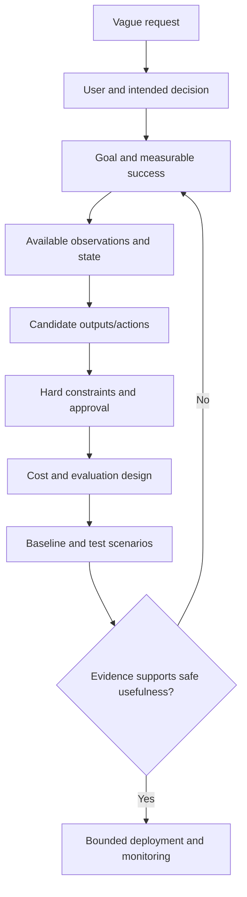

# AI Problem Formulation: Goals, State, Actions, Constraints, Costs, and Evaluation

## A. Concept title

**AI problem formulation** is the process of translating an informal need into a precise task that a program, search procedure, or learning system can attempt to solve. A useful formulation specifies a goal, the information available, possible outputs/actions, constraints, costs, and a way to evaluate success.

## B. Learning objectives

By the end, you can:

- Turn a vague request into an explicit objective and measurable success criteria.
- Distinguish **state**, **observation**, **action**, **transition**, **constraint**, **cost**, and **evaluation metric**.
- Represent a small decision problem with a table or Python data structure.
- Compare alternatives without confusing a low-cost recommendation with permission to execute it.
- Formulate a network troubleshooting assistant as read-only decision support.
- Recognize underspecification, proxy objectives, unsafe actions, and evaluation leakage.

## C. Prerequisites

Read [Introduction to Artificial Intelligence](../lessons/01_introduction_to_artificial_intelligence.md). Basic Python lists, dictionaries, and functions are useful but not required; the examples explain them. Later courses will formalize search, optimization, probability, and reinforcement learning.

## D. Beginner-friendly explanation

“Make the network better” is not a computer-ready task. Better could mean lower latency, fewer dropped packets, more availability, lower cost, or a safer change. Those goals can conflict.

A precise task states:

- **Goal:** what desired outcome counts as success?
- **State/context:** what facts are currently known?
- **Observation:** which part of reality is measured and available to the program?
- **Actions:** what outputs or possible next steps are considered?
- **Constraints:** which actions or outcomes are prohibited or required?
- **Cost:** how do we compare permitted alternatives?
- **Evaluation:** what evidence tells us whether the task succeeded?

For an initial AI assistant, the output might be “show the operator relevant evidence” rather than “change a router.” That smaller task is easier to test and keeps consequential decisions with the responsible human.

## E. Why this concept exists

An algorithm optimizes what it is given—not necessarily what its user intended. An unclear objective can produce an irrelevant answer. A missing constraint can allow an unsafe action. A weak metric can reward a system that looks successful while failing the actual need.

Formulation makes assumptions and boundaries visible before model selection. Often it also reveals that an ordinary deterministic program, a better data source, or a human procedure is more appropriate than AI.

## F. Real-world analogy

Suppose you ask a delivery driver to “get the package there quickly.” The driver still needs a destination, current location, legal roads, vehicle restrictions, and a definition of “quickly.” A shortest route through a closed road is not a good solution. The road rules are constraints; time is a cost; successful delivery is the goal.

Network troubleshooting is similar: “restore service now” is insufficient without affected scope, evidence, permitted diagnostic steps, change windows, risk constraints, and a definition of restored service.

## G. Technical explanation

### Components of a formulation

| Component | Meaning | Synthetic network example |
|---|---|---|
| Goal | Desired condition or output | Prioritize useful diagnostic evidence for an operator |
| State | Relevant variables describing the situation | Site, time, interface counters, neighbor status |
| Observation | Data actually accessible to the program | Sanitized telemetry snapshot; may be incomplete |
| Action | Candidate output or state-changing operation | Inspect counters, inspect routing neighbor, reset interface |
| Transition | How a chosen action changes state | A reset could interrupt a link; a read-only query should not |
| Constraint | Hard requirement or forbidden condition | No device writes; protect secrets; require approval |
| Cost/objective | Preference among permitted choices | Minimize investigation time while maximizing evidence |
| Metric | Measured assessment of quality | Incident recall at a fixed review capacity |

A **hard constraint** filters out unacceptable candidates. A **soft cost** ranks remaining candidates. Do not encode a safety prohibition as merely a large penalty: a sufficiently large benefit could otherwise outweigh it.

### From vague request to specification

1. Name the user and decision being supported.
2. Define success in observable terms.
3. List inputs and what may be missing, stale, or uncertain.
4. Enumerate outputs/actions and mark side effects.
5. State hard constraints and approval requirements.
6. Choose costs and evaluation metrics that reflect error consequences.
7. Construct representative test cases, including failure and abstention cases.
8. Decide how a human can inspect, reject, or disable recommendations.



## H. Internal working mechanism

Once a task is formulated, a solver receives an instance: a concrete state/observation and the declared rules. It generates or scores candidate outputs. Constraints are checked before ranking. A chosen output is then measured against success criteria. For a learning system, labeled examples or feedback may be used to estimate a policy/model, but formulation still defines what the labels, reward, and evaluation actually mean.

For decision support, keep **recommendation** and **execution** separate. The recommendation component can explain evidence; an independent authorization layer controls tools and permissions. A language model's statement that an action is safe is not an authorization check.

## I. Architecture and diagrams

```text
User need
   │ formalize
   ▼
Task specification ──► observations/state
   │                         │
   ├── goals/metrics          ▼
   ├── constraints       candidate generation
   └── costs                  │
                              ▼
                    validate constraints
                              │
                              ▼
                    rank / abstain / explain
                              │
                              ▼
                  human review (if consequential)
```

The notebook visualizes candidate investigation steps by estimated time, risk, and information value. These numbers are illustrative teaching inputs, not empirical measurements.

## J. Mathematical foundation

For a candidate action \(a\), define a soft cost:

\[
J(a)=\alpha\,t(a)+\beta\,r(a)-\gamma\,i(a)
\]

- \(J(a)\): total illustrative cost; lower is preferred among allowed candidates.
- \(t(a)\): estimated time units.
- \(r(a)\): normalized operational risk (illustrative range 0 to 1).
- \(i(a)\): information value (illustrative range 0 to 1).
- \(\alpha,\beta,\gamma\): nonnegative weights expressing the relative importance of time, risk, and information.
- The negative information term rewards actions expected to provide useful evidence.

For a read-only counter inspection, let \(t=2\), \(r=0\), \(i=0.6\), and choose \(\alpha=1,\beta=10,\gamma=2\):

\[
J=1(2)+10(0)-2(0.6)=0.8
\]

For a routing-neighbor inspection with \(t=3,r=0,i=0.9\), \(J=3-1.8=1.2\). The first candidate has lower cost under these arbitrary weights. This is not proof it is diagnostically correct; it only demonstrates how assumptions influence ranking.

Now consider an interface reset with \(t=1,r=0.8,i=0.2\). Its soft cost is \(1+8-0.4=8.6\), but the more important property is a hard constraint: it is prohibited in this lab. Even if someone changed the weights to make its score attractive, the hard constraint still excludes it unless the separate human-approval condition is satisfied.

## K. Python implementation

The [reusable implementation](05_problem_formulation.py) defines typed task and candidate-action data structures, validates candidate actions, checks constraints, and ranks options using the equation above. It uses only the Python standard library; no API, model, or network connection is required.

Run from the course root:

```powershell
python 07_Artificial_Intelligence_Fundamentals\02_AI_Problem_Formulation_Visual_Examples\05_problem_formulation.py
```

The notebook imports the same implementation and prints its actual result. The `reset_interface` candidate is represented as data only; the module has no mechanism to execute it.

## L. Code walkthrough

1. `CandidateAction` stores a name, estimated time, risk, information value, and whether the action changes state.
2. `TaskFormulation` stores the goal, constraints, weights, and prohibited action names.
3. `validate` checks the specification's weights and rejects negative or out-of-range estimates.
4. `score` computes \(J(a)\), but only after validating the candidate.
5. `rank_candidates` filters prohibited state-changing actions unless an explicit human approval flag is supplied, then sorts the remaining options by score.
6. The demonstration prints a read-only recommendation and reports the blocked reset separately. It does not perform any action.

An explicit approval flag is only a teaching demonstration of a boundary; production authorization must use authenticated identities, scoped permissions, policy enforcement, audit, and change controls outside model-generated content.

## M. Multiple examples

- **Beginner:** define a goal such as “convert latency seconds to milliseconds” and specify valid input range and expected output.
- **Intermediate:** choose among collecting counters, checking a routing neighbor, or reviewing a change log using declared costs.
- **Advanced:** introduce hard constraints, abstention, and a separate authorization step; test weight sensitivity without relaxing prohibited-action rules.
- **Real-world:** build an offline, read-only network incident assistant that ranks evidence for an operator and cites the telemetry fields used.

## N. Common mistakes

- **Vague goal:** “improve performance” does not specify which performance, for whom, or over what period.
- **Metric substitution:** minimizing average latency can hide severe packet loss or tail latency.
- **Softening safety:** a forbidden action must be a hard constraint, not merely a high risk penalty.
- **Ignoring unavailable data:** the model cannot reason from telemetry it never receives.
- **Confusing correlation with causation:** an associated signal does not prove root cause.
- **Leaking future information:** evaluation features must reflect what was available at the decision time.
- **Unbounded output authority:** recommendations should not gain tool permissions simply because they are expressed confidently.
- **No abstention route:** when evidence is incomplete, “insufficient evidence” can be better than a forced answer.

## O. Comparisons

| Concept | Question answered | Example |
|---|---|---|
| Goal/objective | What outcome is sought? | Provide useful diagnostic evidence |
| Constraint | What must never or always happen? | No writes in the lab |
| Cost | Which permitted option is preferred? | Prefer lower time and risk |
| Metric | How is performance measured? | Recall and alert burden |
| Policy | How is an output/action selected? | Choose the lowest-cost permitted inspection |
| Authorization | Who may execute a consequential action? | An authenticated operator under change control |

## P. Practical applications

Problem formulation is used before classification, forecasting, search, planning, RAG, agents, and automation. In cloud/network operations, define whether the system detects, summarizes, recommends, or executes. For a first deployment, prefer detection or evidence retrieval, with explicit uncertainty and a human decision boundary.

## Q. Performance considerations

Scoring \(A\) candidates is \(O(A)\); sorting them is \(O(A\log A)\). Computation here is trivial. Real costs arise from collecting/normalizing data, querying models or telemetry, explaining recommendations, false alerts, latency, and human review. A formulation should include operational budgets and review capacity, not just algorithm runtime.

## R. Security and limitations

Task inputs may contain secrets, malicious instructions, stale state, or misleading labels. Limit data access, sanitize logs, validate schemas and units, use least privilege, and separate untrusted model output from control-plane authorization. Synthetic scores in the examples are assumptions, not calibrated probabilities or real risk estimates.

## S. Interview preparation

### Beginner

1. **What is problem formulation?** Turning an informal need into explicit inputs, goals, outputs, constraints, costs, and evaluation criteria.
2. **What is a state?** A representation of relevant variables about a situation.
3. **What is a constraint?** A requirement that defines which solutions are allowed.
4. **How does cost differ from a constraint?** Cost ranks allowed options; a hard constraint excludes disallowed ones.
5. **Why define a metric before training?** To ensure evaluation reflects the intended task rather than a convenient but misleading score.

### Intermediate

1. **Why separate observation from state?** The underlying situation may contain facts the system cannot observe; the solver should not assume missing information.
2. **Why use a baseline?** It shows whether complexity adds measured value over a simple alternative.
3. **How handle conflicting goals?** State tradeoffs, constraints, weights or Pareto choices, and who owns the decision.
4. **What is abstention?** Returning that evidence is insufficient rather than forcing an uncertain output.
5. **Why time-split network telemetry?** To approximate future use and avoid training on information that occurs after evaluation events.

### Advanced

1. **Why is a weighted objective not a safety policy?** Weights permit tradeoffs; a sufficiently favorable score can override a soft penalty. Hard constraints and independent authorization are needed.
2. **How could a proxy objective fail?** The system optimizes the measurable proxy while missing the real user goal, such as reducing mean latency while worsening tail delay.
3. **How define an evaluation for rare faults?** Use time/group-separated data, report precision/recall and alert burden at operating thresholds, inspect missed incidents, and account for label uncertainty.
4. **How test formulation robustness?** Vary assumptions/weights, test missing and contradictory observations, include prohibited actions and abstention cases, and review with domain experts.
5. **How constrain an agent?** Enforce tool permissions outside model text, default to read-only, validate schemas, require authenticated approval for side effects, log actions, and provide a disable/rollback path.

## T. Hands-on exercises

See the separate [exercise notebook](03_AI_Problem_Formulation_Exercises.ipynb) and [solution notebook](04_AI_Problem_Formulation_Solutions.ipynb). Exercises cover a beginner task specification, metric selection, weighted-cost calculations, and a bounded network triage design.

## U. Mini-project

Create a **read-only incident triage specification** using synthetic telemetry. Define user, goal, observations and missing-data behavior, candidate recommendations, hard constraints, success metrics, review capacity, evidence shown, and conditions for abstention. Include a small program that validates a candidate and prints its cost without executing an operational step.

Acceptance: synthetic data only; no credentials or device integration; prohibited actions cannot be selected without explicit review policy; calculation and assumptions are documented; test at least one malformed input and one blocked action.

## V. Knowledge check

- [ ] I can define goal, observation/state, action, constraint, cost, and metric.
- [ ] I can translate “make it better” into an observable target.
- [ ] I can explain why a hard safety prohibition is not just a large penalty.
- [ ] I can compute and interpret the weighted example by hand.
- [ ] I can identify a read-only first step for network troubleshooting.
- [ ] I can explain how missing, stale, or future-leaked data changes evaluation.
- [ ] I can describe a human approval and abstention boundary.

## W. Summary

Problem formulation makes the intended decision explicit before choosing an AI technique. It identifies goals, available observations, candidate outputs, hard constraints, costs, and evaluation. Soft costs rank allowed alternatives; hard constraints exclude forbidden options. In consequential settings, recommendation and execution require separate controls. The next module in this sequence is search and planning, where explicit state/action/cost models are used to find sequences of steps.

## X. References

This lesson uses a self-contained synthetic example and does not make external factual claims requiring a citation. The course's introductory references are in [lesson 01](../lessons/01_introduction_to_artificial_intelligence.md#x-references). Search/planning and reinforcement-learning modules will add topic-specific references when authored.
