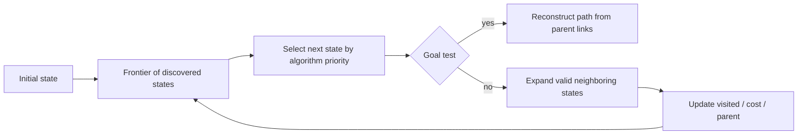

# Search and Planning: State Spaces, BFS, Dijkstra, and A*

## A. Concept title

**Search** is the systematic exploration of possible states or paths to find one satisfying a goal. **Planning** is choosing a sequence of actions that takes a system from an initial state toward a goal while respecting costs and constraints. A **state space** represents states and transitions as a graph.

## B. Learning objectives

You should be able to:

- Define a search problem using an initial state, goal test, actions, transition model, and path cost.
- Distinguish a node/state, an edge/action, a path, and a heuristic.
- Explain and implement breadth-first search (BFS), uniform-cost search/Dijkstra, and A*.
- Choose a search algorithm based on edge costs and heuristic assumptions.
- Trace a small search by hand and read a graph visualization.
- Explain complexity, limitations, and safe use in network engineering examples.

## C. Prerequisites

Read the preceding [AI problem-formulation notes](../02_AI_Problem_Formulation_Visual_Examples/01_AI_Problem_Formulation_Complete_Notes.md). Basic Python functions, dictionaries, lists, and sets help; the code walkthrough introduces their roles.

## D. Beginner-friendly explanation

Suppose you need to find a path from a starting room to an exit. A map can be represented as locations (states) connected by passages (actions). Search checks possible routes. If all passages count as one step, the route with the fewest steps is appropriate. If passages have different travel costs, choose the route with the smallest total cost instead.

A search algorithm does not know what “best” means unless we specify a goal and cost. A* can use a **heuristic**: an estimate of the remaining cost to the goal. A good heuristic helps explore fewer alternatives, but if it overestimates, the algorithm can return a non-optimal route.

## E. Why this concept exists

Many AI tasks involve choosing among alternatives: route finding, puzzle solving, scheduling, troubleshooting sequences, and planning actions. Search provides a clear way to explore a finite or structured set of possibilities. It is also a foundation for understanding planners, game search, and some agent workflows.

## F. Real-world analogy

Finding a driving route is a weighted graph problem: intersections are nodes, roads are edges, and travel time or distance is edge cost. A route planner can use straight-line distance as an estimate of remaining travel, but traffic, closures, and restrictions affect whether that estimate and the route model are appropriate.

In a network troubleshooting runbook, diagnostic states might represent which evidence has been gathered. Edges are possible next checks. Search could find an efficient sequence of read-only inspections; it should not execute a disruptive change without a separate authorization process.

## G. Technical explanation

A search problem typically specifies:

1. **Initial state** \(s_0\): where the search begins.
2. **State space** \(S\): possible situations.
3. **Actions** \(A(s)\): choices available in state \(s\).
4. **Transition model** \(T(s,a)\): resulting state after action \(a\).
5. **Goal test** \(G(s)\): whether a state satisfies the objective.
6. **Path cost** \(g\): accumulated cost along a sequence of edges.

| Algorithm | Frontier ordering | Edge-cost assumption | Optimality condition |
|---|---|---|---|
| BFS | First in, first out | Equal cost per edge (for fewest edges) | Finds fewest-edge path |
| Dijkstra / uniform-cost search | Lowest accumulated \(g\) first | Nonnegative edge costs | Finds minimum-cost path |
| A* | Lowest \(f=g+h\) first | Nonnegative edge costs | Optimal with suitable admissible heuristic and graph-search handling |

BFS is not a substitute for Dijkstra when edge costs differ. Dijkstra is often described as uniform-cost search in AI. A* adds an estimate \(h(n)\) of remaining cost.

## H. Internal working mechanism

### BFS

Put the start in a FIFO queue and mark it visited. Repeatedly remove the oldest state; if it is the goal, reconstruct the path. Otherwise enqueue unvisited neighbors. FIFO order explores by number of edges.

### Dijkstra

Maintain the best-known cost \(g(n)\) for each node. A min-priority queue chooses the lowest-cost discovered node. When a cheaper route to a neighbor is found, update its cost and parent. With nonnegative costs, removing the least-cost frontier node finalizes its best distance.

### A*

Prioritize a node by:

\[
f(n)=g(n)+h(n)
\]

Here \(g(n)\) is the known cost from start to \(n\), and \(h(n)\) estimates the remaining cost from \(n\) to a goal. **Admissible** means \(h(n)\) never exceeds the true cheapest remaining cost. With an admissible heuristic and suitable graph-search implementation (including reopening nodes if needed for inconsistent heuristics), A* can find an optimal path. The lesson implementation uses a consistent heuristic for its main example.

## I. Architecture and diagrams



The notebook plots a schematic network graph. Node coordinates are layout positions for the picture, not geographic coordinates. Edge labels are synthetic cost units, not measured network latency.

## J. Mathematical foundation

### Path cost

For path \(p=(s_0,s_1,\ldots,s_k)\), with edge cost \(c(s_i,s_{i+1})\):

\[
g(p)=\sum_{i=0}^{k-1}c(s_i,s_{i+1})
\]

Each \(c\) is the cost of one edge; \(k\) is the number of edges; \(g(p)\) is the accumulated path cost. For route `A → B → D → G` with costs \(2+2+3\), total cost is 7 units.

### A* priority

\[
f(n)=g(n)+h(n)
\]

For node \(n\), \(f\) is its estimated total solution cost, \(g\) is exact cost already paid, and \(h\) is estimated remaining cost. If \(h(n)=0\) everywhere, A* reduces to Dijkstra's priority rule. If \(h\) overestimates, a cheaper path may be delayed and optimality can be lost.

### Complexity

BFS on adjacency lists is \(O(V+E)\) time and \(O(V)\) auxiliary storage for visited/parents/frontier, where \(V\) is vertices and \(E\) edges. Dijkstra with a binary heap is typically \(O((V+E)\log V)\). A* worst-case time and memory can be exponential in solution depth for large branching spaces; a strong valid heuristic can reduce explored states but does not remove worst-case risk.

## K. Python implementation

The dependency-free implementation is in [05_search_algorithms.py](05_search_algorithms.py). It includes BFS for unweighted steps, Dijkstra for nonnegative weighted graphs, and A* with a caller-provided heuristic. The demonstration graph and heuristic are synthetic. Matplotlib is used only in the notebook for plotting.

Run from the course root:

```powershell
python 07_Artificial_Intelligence_Fundamentals\03_Search_and_Planning_Visual_Examples\05_search_algorithms.py
```

## L. Code walkthrough

- The graph is a dictionary: each key is a node and its value is a list of `(neighbor, cost)` pairs.
- `parents` remembers the previous node on the best discovered route so a result can be reconstructed.
- BFS uses a `deque`, which efficiently removes from the front.
- Dijkstra/A* use `heapq`, a min-priority queue represented as a list.
- `best_cost` stores the least known \(g\)-cost; stale heap entries are skipped.
- A* calls the supplied heuristic to calculate \(f=g+h\). The caller owns the heuristic's correctness assumptions.
- No search function performs a real-world action; output is only a path description.

## M. Multiple examples

- **Beginner:** traverse a small unweighted maze with BFS.
- **Intermediate:** use Dijkstra to minimize total synthetic link cost.
- **Advanced:** compare A* with a consistent heuristic against a deliberately overestimating heuristic.
- **Real-world engineering:** rank read-only inspection routes through a synthetic topology. Edge labels are abstract investigation costs, not real BGP behavior or measured latency.

## N. Common mistakes

- Using BFS to minimize different edge costs.
- Using Dijkstra with negative edges.
- Forgetting to update a node's parent when a cheaper path is found.
- Marking nodes visited too early in weighted search.
- Assuming a heuristic is valid because it “looks close.”
- Comparing route cost labels as if they were real latency measurements.
- Treating a planned route as permission to execute configuration changes.

## O. Comparisons

| Property | BFS | Dijkstra | A* |
|---|---|---|---|
| Uses accumulated edge costs | No | Yes | Yes |
| Uses goal-distance estimate | No | No | Yes |
| Handles unequal nonnegative edge costs | No, not for cost optimality | Yes | Yes |
| Main control structure | FIFO queue | Priority queue | Priority queue |
| Common use | Fewest transitions | Cheapest known route | Goal-directed cost search |

## P. Practical applications

Search appears in route planning, dependency resolution, game search, automated planning, puzzle solving, and diagnostic decision trees. Network applications must encode real protocol/operational constraints correctly; a generic graph path is not a full BGP/OSPF route computation or root-cause analysis.

## Q. Performance considerations

The number of explored states often dominates runtime and memory. Adjacency lists are efficient for sparse graphs. A* may save work with a useful heuristic but stores frontier and parent data. For large systems, consider state abstraction, pruning, caching, bounded search, and explicit time/memory budgets.

## R. Security and limitations

Search is only as safe as its state model, constraints, inputs, and execution boundary. Malicious or stale topology data can produce misleading routes. Keep diagnostics read-only, validate data and costs, avoid putting credentials in graph attributes, and require human authorization for side effects. Optimality is only relative to the encoded graph and cost.

## S. Interview preparation

### Beginner

1. What is a state-space graph?
2. Why does BFS find a minimum-edge path when every edge has equal cost?
3. What is a path cost?
4. What is a priority queue?
5. What information is needed to reconstruct a path?

### Intermediate

1. Why does BFS not generally minimize weighted cost?
2. What assumption does Dijkstra make about edge weights?
3. What is the A* evaluation function?
4. What does it mean for a heuristic to be admissible?
5. Why can stale priority-queue entries be ignored?

### Advanced

1. How does heuristic consistency relate to node re-expansion?
2. Construct an overestimating heuristic that makes A* return a suboptimal path.
3. Explain the time and memory tradeoff between Dijkstra and A*.
4. How would you model time-dependent edge costs?
5. Why is a shortest graph path not automatically a safe network change plan?

## T. Hands-on exercises

Attempt [the exercise notebook](03_Search_and_Planning_Exercises.ipynb) before viewing [solutions](04_Search_and_Planning_Solutions.ipynb). Exercises cover manual traces, weighted versus unweighted routes, heuristic checks, and synthetic network triage.

## U. Mini-project

Implement a route planner over a synthetic topology. Compare BFS fewest hops, Dijkstra minimum abstract cost, and A* with a documented heuristic. Include disconnected nodes and invalid costs in tests. Explain why the route is advisory and why real network operations require protocol-specific data and change authorization.

## V. Knowledge check

- [ ] I can identify the initial state, goal, transitions, and path cost.
- [ ] I can select BFS, Dijkstra, or A* for a stated edge-cost model.
- [ ] I can calculate \(g\), \(h\), and \(f\) for a node.
- [ ] I can explain admissibility and why overestimation can break optimality.
- [ ] I can trace how parent links reconstruct a route.
- [ ] I can describe the algorithm's limits and safe operational boundary.

## W. Summary

Search explores modeled states; planning uses action sequences to reach a goal. BFS is suited to equal-cost steps, Dijkstra to nonnegative weighted paths, and A* uses \(f=g+h\) to guide cost-aware search. The result is optimal only under the model and algorithm assumptions. The next lesson should cover knowledge representation and reasoning, including rules, facts, and how structured knowledge changes planning.

## X. References

This lesson's examples are self-contained and use no external dataset. For foundational coverage, consult the AI search and planning chapters in a current university-level AI textbook; verify the edition used by your course before citing page numbers. No external URL is asserted here.
