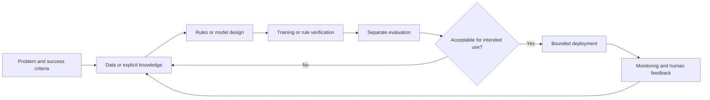

# 01 — Introduction to Artificial Intelligence: What AI Is, How It Works, Major Categories, Applications, and the Learning Path

## A. Concept title

**Artificial Intelligence (AI)** is the field of designing and studying computational systems that perform tasks commonly associated with intelligent behavior. The term is broad: it includes systems built from explicit rules, systems that learn patterns from data, and systems that combine these approaches. It does not mean that a computer necessarily thinks, understands, or has human-like awareness.

## B. Learning objectives

After this lesson, you should be able to:

- Explain AI, machine learning (ML), deep learning (DL), and generative AI in relation to one another.
- Distinguish rule-based, supervised, unsupervised, self-supervised, and reinforcement-learning approaches at a high level.
- Trace the lifecycle from problem definition and data through training or rule design, inference, evaluation, and monitoring.
- Identify appropriate examples, limitations, risks, and simple non-AI alternatives.
- Run and modify two small Python demonstrations and interpret what they do—and do not—show.
- Describe a realistic sequence for progressing from beginner foundations to AI engineering and specialization.

## C. Prerequisites

No AI or programming knowledge is required. Familiarity with files and a terminal is helpful. If Python is not installed, use the [Getting Started instructions](../../00_Getting_Started/README.md) and root [setup guide](../../README.md). Later mathematics and ML ideas are introduced intuitively here and derived in the relevant future lessons.

## D. Beginner-friendly explanation

Imagine a program that receives information and produces a useful result. A calculator maps typed numbers and an operation to an answer. A fixed rule might say, “If a sensor value is above 80, show a warning.” An AI system might instead learn from many prior sensor readings which patterns often come before a failure.

The important difference is not that one system is “smart” and the other is not. It is **how the behavior is produced**:

- In ordinary programmed software, a developer specifies the procedure and conditions.
- In a rule-based AI system, a human writes explicit knowledge or rules, often to solve a task associated with reasoning.
- In machine learning, a training procedure uses examples or interaction to fit a model. The learned model then maps inputs to predictions or actions.
- In generative AI, a model produces new content—such as text, images, audio, or code—according to patterns learned during training and its current input.

**Data** means recorded observations. A **model** is a rule-based or learned representation that turns inputs into outputs. **Training** is the process that fits a learned model. **Inference** is using a model after training. AI is an engineering choice for a defined task, not a magical property or proof of understanding.

## E. Why this concept exists

Many useful tasks involve too many possible inputs for people to write and maintain a separate condition for every case. Images vary in lighting, written questions vary in wording, and network telemetry has many interacting signals. AI methods offer ways to encode knowledge or extract patterns so a computer can help with such tasks.

AI is not automatically the best solution. If requirements are stable and exact—such as checking whether a field is missing—a direct validation rule is usually simpler, faster, cheaper, and easier to audit. Use AI when its flexibility brings enough value to justify uncertainty, data needs, evaluation work, and operational risk.

## F. Real-world analogy

Consider a mechanic deciding whether a vehicle may have a battery problem:

- **Fixed software rule:** warn if measured voltage is below a chosen threshold.
- **Supervised learning:** examine past labeled service cases and learn a pattern associated with battery failure.
- **Unsupervised learning:** group unusual electrical readings without having a label for each fault.
- **Generative AI:** summarize the sensor history and service notes in natural language.
- **Human expert:** check the measurements, consider other causes, and decide what action is safe.

The analogy also shows the boundary: a fluent summary is not a diagnosis, and a learned correlation is not proof that a component caused the failure.

## G. Technical explanation

### AI, ML, deep learning, and generative AI

These labels describe overlapping scopes, not competing categories:

| Term | Meaning | Example |
|---|---|---|
| AI | Broad study/engineering field for systems that perform intelligent-seeming tasks | A rule-based diagnostic assistant or a learned vision model |
| ML | Methods that fit patterns or behavior using data or interaction | A classifier trained on labeled incidents |
| Deep learning | ML based on neural networks with multiple learned layers | A neural network recognizing objects in images |
| Generative AI | Models that generate content or sequences | A language model drafting a response |

Not every AI system learns; not every ML model is deep; not every generative model is a language model. These terms should be used to describe mechanisms, not as a ranking of capability.

### Major approaches

| Approach | Training signal or source of behavior | Typical use | Main caveat |
|---|---|---|---|
| Rule-based/symbolic | Human-authored rules, facts, or search procedures | Policies, constraints, logic, explainable decision paths | Rules may be incomplete, brittle, or costly to maintain |
| Supervised learning | Examples paired with target labels | Classification and regression | Labels can be noisy or biased; distribution can change |
| Unsupervised learning | Inputs without supplied task labels | Clustering, representation, anomaly exploration | A discovered pattern is not automatically meaningful |
| Self-supervised learning | Training targets derived from the input itself | Learning reusable representations, language-model pretraining | Pretraining success does not guarantee reliable task behavior |
| Reinforcement learning | Feedback/reward from sequential interaction | Simulated control, strategy learning | Reward design, exploration, and deployment can be hazardous |
| Hybrid systems | Multiple mechanisms, e.g. rules plus learned ranking | Guarded decision support, search plus model scoring | Interfaces and responsibility boundaries need careful design |

These categories can overlap. For example, a language model is trained largely with a self-supervised objective, then may be adapted or evaluated using other feedback.

### Common task shapes

- **Classification:** choose a category, such as “likely fault” or “normal.”
- **Regression:** estimate a number, such as expected demand.
- **Clustering:** group examples by similarity without preassigned classes.
- **Forecasting:** estimate future values from time-ordered history.
- **Generation:** produce a sequence or sample, such as a draft or image.
- **Decision/control:** select actions over time, often under constraints.

Task names do not tell you whether the output is correct or useful. That requires an evaluation design tied to the actual use.

## H. Internal working mechanism

A typical ML workflow is:

1. **Define the task.** Specify the user, input, intended output, allowed use, failure cost, and measurable success criteria.
2. **Collect and inspect data.** Check provenance, permissions, coverage, missing values, and labels.
3. **Represent examples.** Convert raw observations into model inputs called features, or use a model's learned representation.
4. **Choose a baseline and model.** Start with a simple rule or small model that can be compared against.
5. **Train.** A learning algorithm adjusts model parameters to reduce a chosen error measure on training examples.
6. **Evaluate separately.** Use data not used to fit the model to estimate performance on future-like examples; avoid leaking answers into training.
7. **Deploy with boundaries.** Define who can use outputs, what actions are permitted, and when to fall back or ask a human.
8. **Monitor and revise.** Observe errors, data shifts, latency, cost, and harms; retrain or retire only through controlled review.



For a rule-based system, the “training” stage may be rule authoring and verification. For an ML system, training estimates parameters from examples. For a generative model, inference often produces one token or other output step at a time, conditioned on prior input/output context; that deeper mechanism belongs in the transformer and LLM modules.

## I. Architecture and diagrams

### Learning-system lifecycle

```text
Real-world task
    │
    ├── requirements, constraints, risk, success metric
    ▼
Examples / signals ──► representation ──► learning algorithm
                                               │
                                               ▼
                                      fitted model parameters
                                               │
New input ──► preprocessing ──► inference ──► prediction/action
                                               │
                                   evaluation, review, monitoring
```

### Where the terms fit

```text
Artificial Intelligence
├── Explicit knowledge and search (e.g., rules, planning)
└── Machine Learning
    ├── Classical ML (e.g., linear models, trees)
    └── Deep Learning (multi-layer neural networks)
        └── Many modern language, vision, and multimodal models

Generative AI is a capability/task family that can be implemented
with deep learning, but generation is not limited to one architecture.
```

## J. Mathematical foundation

The introductory rule example does not require calculus. A tiny supervised-learning example makes the role of data and evaluation concrete.

Suppose a model predicts whether an alert is needed from one numeric measurement \(x\). We have four labeled examples:

| Measurement \(x_i\) | Label \(y_i\) |
|---:|---:|
| 10 | 0 |
| 12 | 0 |
| 80 | 1 |
| 90 | 1 |

Here \(x_i\) is the \(i\)-th input measurement and \(y_i\in\{0,1\}\) is its known class label. A simple model computes the mean measurement in each class:

\[
\mu_c = \frac{1}{n_c}\sum_{i:y_i=c}x_i
\]

- \(c\) is a candidate class, here 0 or 1.
- \(n_c\) is the number of examples whose label equals \(c\).
- \(\mu_c\) is the class's mean measurement.
- The sum adds the measurements belonging to that class.

For class 0, \(\mu_0=(10+12)/2=11\). For class 1, \(\mu_1=(80+90)/2=85\). For a new measurement \(x=70\), compare its absolute distance to each mean:

\[
\hat{y}(x)=\underset{c\in\{0,1\}}{\operatorname{argmin}} |x-\mu_c|
\]

The symbol \(\hat{y}\) means predicted label; \(\operatorname{argmin}\) selects the class \(c\) with the smallest value; \(|x-\mu_c|\) is absolute distance. At \(x=70\), distances are \(|70-11|=59\) and \(|70-85|=15\), so the model predicts class 1.

This is a **nearest-centroid** rule. It is deliberately small and not a recommended network-fault model: the sample is tiny, the two classes are artificially separated, the features have no context, and prediction accuracy says nothing about safe action.

For an evaluated set containing \(N\) examples, empirical accuracy is:

\[
\text{accuracy}=\frac{\text{number of correct predictions}}{N}
\]

If the four examples above were used only to demonstrate prediction and all four were predicted correctly, the arithmetic accuracy would be \(4/4=1\), or 100%. That number is not evidence of real-world quality: evaluating on the same examples used to design/fix a model is optimistic, and an imbalanced dataset can make accuracy misleading. Later lessons derive better split strategies and task-specific metrics.

## K. Python implementation

Both examples require Python 3.11+ and no third-party packages. Run them from the repository root:

```powershell
python 07_Artificial_Intelligence_Fundamentals\examples\ai_categories.py
python 07_Artificial_Intelligence_Fundamentals\examples\tiny_classifier.py
```

`ai_categories.py` contrasts explicit rules and a small hand-coded nearest-centroid learner. `tiny_classifier.py` focuses on the training/prediction arithmetic. Expected output is documented in each script. These examples are deterministic; they do not call an external model or API.

## L. Code walkthrough

Read [ai_categories.py](../examples/ai_categories.py) and [tiny_classifier.py](../examples/tiny_classifier.py) alongside this section.

In the nearest-centroid example:

1. `training_examples` stores pairs of a numeric input and its known class. These are examples, not a realistic dataset.
2. `fit_centroids` groups values by label and computes one arithmetic mean for each class. That is the tiny model's learned state.
3. `predict` computes the distance from a new value to each stored centroid and returns the label with the smaller distance.
4. `evaluate` compares predictions to known labels and counts correct cases.
5. `main` prints centroids, predictions, and a small demonstration score.

The code explicitly rejects empty data and unrecognized labels rather than silently making a prediction. In real systems, input validation, data splitting, metric selection, and operational safeguards require far more care.

## M. Multiple examples

1. **Beginner:** the `needs_review` function in `ai_categories.py` uses a clearly stated threshold rule.
2. **Intermediate:** the same file trains and applies the nearest-centroid classifier to toy labeled measurements.
3. **Advanced:** the lifecycle diagram and [network triage project](../examples/README.md) ask you to design a read-only pipeline with held-out evaluation, uncertainty, and a human-review boundary.
4. **Real-world engineering:** a network team might use a model to rank sanitized telemetry windows for analyst review. A separate deterministic guard should enforce safety policy; the model must not change device configuration. False negatives and false positives should be measured against incident labels, with time-based evaluation where appropriate.

The advanced and engineering examples are design exercises, not claims that a production system has been built here.

## N. Common mistakes

- **Treating AI as one algorithm:** identify the actual mechanism and task before discussing capability.
- **Equating fluent output with truth:** generated language can be plausible but unsupported.
- **Calling a correlation a cause:** a predictor can use a proxy or coincidence rather than a causal mechanism.
- **Training and testing on the same examples:** this measures remembered examples, not reliable generalization.
- **Using accuracy alone:** with rare failures, a model that always predicts “normal” may score highly while missing every incident.
- **Assuming more data fixes everything:** poor labels, biased coverage, leakage, or wrong objectives can remain.
- **Automating action too early:** a prediction should not be allowed to trigger a disruptive change without explicit design, authorization, and human approval.
- **Thinking “unsupervised” means objective truth:** clusters depend on features, distance, and chosen parameters.

## O. Comparisons

| Choice | Strength | Weakness | Prefer when |
|---|---|---|---|
| Deterministic software | Predictable, testable, inexpensive | Requires explicit coverage of cases | Rules are clear and stable |
| Rule-based AI | Auditable reasoning paths and constraints | Brittle with unanticipated cases | Domain knowledge can be expressed explicitly |
| Classical ML | Often efficient and useful on structured data | Depends on labels/features and validation | A measured pattern can improve a defined task |
| Deep learning | Learns rich representations from complex data | Data/compute needs, opacity, and operational cost | Inputs are complex and evidence justifies the cost |
| Generative model | Flexible language/content interface | Can invent, omit, or misstate facts | Drafting or synthesis is useful with verification and controls |

## P. Practical applications

AI is used for image and speech recognition, search ranking, translation, recommendations, forecasting, anomaly triage, document retrieval, and content generation. In network engineering it can help classify logs, summarize incidents, detect unusual telemetry, forecast traffic, and retrieve relevant design documents. These are decision-support applications: outputs need measurable quality, traceable evidence where appropriate, and an operational owner.

## Q. Performance considerations

The nearest-centroid implementation stores one mean per class and evaluates a new input in \(O(C)\) time, where \(C\) is the number of classes; training here is \(O(N)\) for \(N\) examples. Those tiny costs are not representative of large neural networks. Real systems also incur data preparation, memory, accelerator, serving, monitoring, and human-review costs. Compare quality, latency, memory, throughput, energy, and cost for the real workload; choose the simplest model that meets requirements.

## R. Security and limitations

Models can memorize sensitive data, reflect systematic skews in their training data, fail under changed conditions, or be manipulated by crafted inputs. Generative systems may expose data or follow untrusted instructions if their surrounding design is unsafe. Limit access to data, minimize retention, validate inputs/outputs, keep permissions narrow, log responsibly, and test misuse and failure cases.

The NIST AI Risk Management Framework describes risk management across design, development, use, and evaluation. It is a resource, not a guarantee that a system is safe or compliant. No model should be treated as a source of authority merely because it produces a confident answer.

## S. Interview preparation

### Beginner questions

1. **What is AI?** A broad field that studies and builds computational systems for tasks associated with intelligent behavior; implementations may be rule-based or learned.
2. **How are AI, ML, and deep learning related?** AI is the broadest field; ML is a set of data/interaction-driven methods; deep learning is ML using multi-layer neural networks.
3. **What is training?** Fitting or selecting a model's behavior from examples or interaction. Rule-based systems may instead be authored and tested.
4. **What is inference?** Applying an already specified or trained system to an input to produce an output.
5. **Give a case where ML is unnecessary.** Checking whether a required field is empty is better handled with an explicit validation rule.

### Intermediate questions

1. **Supervised versus unsupervised learning?** Supervised methods use examples paired with target labels; unsupervised methods seek structure without supplied target labels.
2. **Why separate training and test data?** To estimate performance on examples not used to fit or select the model; repeated tuning on the test set undermines that estimate.
3. **Why can accuracy be misleading?** It can hide poor performance on rare but important classes and ignores different error costs.
4. **What is a baseline?** A simple reference method that anchors whether a more complex method adds measurable value.
5. **Why does distribution shift matter?** Inputs or relationships at deployment may differ from training/evaluation, making historical scores less predictive.

### Advanced questions

1. **How would you evaluate an anomaly detector without reliable labels?** Combine domain review, carefully designed synthetic or injected anomalies, stability checks, operational investigation outcomes, and limits on conclusions; lack of labels leaves uncertainty.
2. **What is data leakage?** Information unavailable at decision time or derived from targets enters training/evaluation, inflating apparent performance.
3. **How do you select a decision threshold?** Use validation data and explicit error costs/capacity constraints, then confirm once on an untouched test set and monitor after deployment.
4. **Why isn't a predictive association a causal explanation?** Confounding, proxies, selection effects, and non-interventional data can create associations without a causal effect.
5. **How would you introduce AI into network operations safely?** Start with synthetic/sanitized data and offline evaluation; deploy read-only recommendations with evidence, calibrated uncertainty, auditability, and human approval; measure incidents and rollback conditions before considering any controlled action.

## T. Hands-on exercises

Attempt the [separate exercise sheet](../exercises/lesson_01_exercises.md) before viewing [solutions](../solutions/lesson_01_solutions.md).

- **Beginner:** exercises 1-3 identify system mechanisms, calculate a nearest-centroid prediction, and critique accuracy.
- **Intermediate:** exercises 4-6 define a useful baseline, choose a split/metric for rare network faults, and describe a monitoring plan.
- **Advanced:** exercises 7-8 design a permission-bounded network triage workflow and critique a generative-AI proposal.

## U. Mini-project

### Read-only network incident triage design

Create a small synthetic dataset of network metric windows (e.g., latency, loss, interface-error rate) with a small set of labeled scenarios. Implement a deterministic baseline and a simple learned or statistical ranking method in a later module. For this introductory lesson, submit a one-page design:

- Define the user, input, output, and prohibited actions.
- List data fields and how synthetic labels are generated.
- Choose a baseline, a time-aware evaluation split, and metrics appropriate to rare incidents.
- Explain what evidence the analyst sees and what uncertainty remains.
- Define the human approval gate and a rollback/disable procedure.

**Acceptance:** no real credentials or customer data; no device writes; explicit false-positive/false-negative discussion; reproducible scenario and reviewable evidence. This is a project specification, not an already implemented operational tool.

## V. Knowledge check

- [ ] I can distinguish AI, ML, DL, and generative AI without claiming they are synonyms.
- [ ] I can explain rule-based, supervised, unsupervised, self-supervised, and reinforcement approaches.
- [ ] I can describe the problem/data/model/evaluation/deployment/monitoring lifecycle.
- [ ] I can explain why test data must be separated from model fitting and repeated tuning.
- [ ] I can give a case where conventional software is preferable.
- [ ] I can explain why an AI recommendation is not automatically true or safe to execute.
- [ ] I can run and modify the two examples and complete exercises without relying on their solutions.

## W. Summary

AI is a broad collection of approaches for building systems that perform tasks associated with intelligent behavior. Some systems encode explicit rules; others fit patterns from labeled examples, unlabeled data, self-generated targets, or interaction. Deep learning is a subset of ML, and generative AI is a capability family rather than a synonym for all AI. A trustworthy engineering workflow begins with a well-defined task, suitable data, a simple baseline, evaluation on appropriately separate examples, bounded deployment, and ongoing monitoring. The next lesson should make problem formulation precise: goals, state, actions, constraints, costs, and success criteria.

## X. References

These references were checked on October 17, 2026. They are authoritative starting points, not a substitute for the lesson's explanations.

1. NIST, [AI Risk Management Framework](https://www.nist.gov/itl/ai-risk-management-framework) — framework overview and risk-management resources. The page notes the framework is being revised; check the official page for current status.
2. Google for Developers, [Machine Learning Crash Course](https://developers.google.com/machine-learning/crash-course/) — practical introductions to ML models, data, evaluation, and related topics.
3. Python Software Foundation, [The Python Tutorial](https://docs.python.org/3/tutorial/) — official Python language tutorial; it assumes basic programming familiarity, so pair with beginner exercises.
4. Stanford Institute for Human-Centered AI, [AI Index Report 2025](https://hai.stanford.edu/assets/files/hai_ai_index_report_2025.pdf) — a dated, evidence-focused overview of AI trends; use newer editions for newer trend claims.

