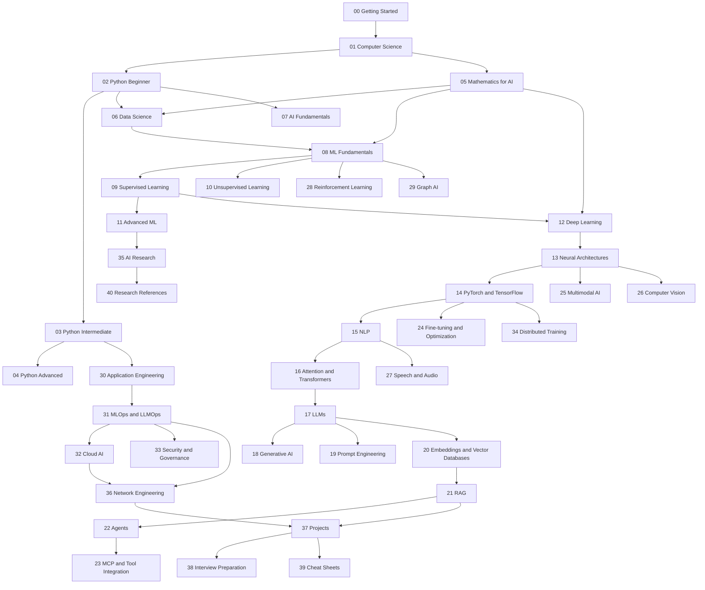

# Course Roadmap

This roadmap is an ordered dependency plan, not a promise that every research specialization can be mastered on a fixed calendar. Hours are focused study estimates; add time for practice, review, and projects. Read the module README for each module's specific prerequisites, objectives, topics, exercises, project, and milestone.

## Stages and completion gates

| Stage | Modules | Estimated focused hours | Completion milestone |
|---|---|---:|---|
| Beginner foundations | 00-08 | 250-400 | Write and test Python programs; explain core AI/ML vocabulary; prepare and inspect a dataset; train and evaluate a baseline model. |
| Intermediate practice | 09-20 | 350-550 | Compare supervised/unsupervised methods; build neural and language-model components; evaluate errors and communicate limitations. |
| Advanced engineering | 21-34 | 450-750 | Build a grounded RAG system and bounded tool workflows; deploy and monitor an application; reason about safety, cost, privacy, and scale. |
| Expert specialization | 35-40 | 400-900+ | Reproduce or critique research, design advanced training/AI systems, and complete a reviewed specialization capstone. |

Ranges overlap in difficulty and depend on prior programming, mathematics, and infrastructure experience. A strong engineer can still need years of research practice to develop research-level mastery.

## Dependency sequence

The diagram shows the main path. Parallel specializations still require their listed prerequisites, and the project track should be practiced throughout rather than postponed until the end.

## Module-by-module plan

| # | Module | Prerequisites | Hours | Required practice / milestone |
|---:|---|---|---:|---|
| 00 | Getting Started | None | 4-8 | Set up Python, VS Code, Git, virtual environments; run and test the first example. |
| 01 | Computer Science Fundamentals | 00 | 25-40 | Trace algorithms, data structures, complexity, processes, files, HTTP, and version control. |
| 02 | Python Beginner | 00-01 | 30-45 | Build small scripts using types, control flow, functions, collections, and exceptions. |
| 03 | Python Intermediate | 02 | 30-45 | Build modular, typed programs; use iterators, files, tests, and package environments. |
| 04 | Python Advanced | 03 | 25-40 | Explain object model, concurrency choices, profiling, packaging, and robust API design. |
| 05 | Mathematics for AI | 01-02 (parallel with 03) | 45-75 | Solve and implement linear algebra, calculus, probability, statistics, and optimization exercises. |
| 06 | Data Science | 02-03, 05 basics | 30-50 | Clean, explore, visualize, split, and document a reproducible dataset. |
| 07 | AI Fundamentals | 00-02 | 15-25 | Complete lesson 01 and compare AI paradigms using explicit examples and limits. |
| 08 | ML Fundamentals | 05-07 | 20-35 | Train a baseline, define a metric, use a holdout split, and explain generalization. |
| 09 | Supervised Learning | 08 | 25-40 | Compare regression, classification, trees, ensembles, and calibration on held-out data. |
| 10 | Unsupervised Learning | 08 | 20-35 | Apply clustering, dimensionality reduction, and anomaly detection with caveats. |
| 11 | Advanced ML | 09-10 | 30-50 | Build validation pipelines; address leakage, imbalance, uncertainty, and interpretability. |
| 12 | Deep Learning Fundamentals | 05, 08 | 30-50 | Derive a small neural network's forward/backward pass and train a baseline. |
| 13 | Neural Network Architectures | 12 | 25-40 | Select and evaluate MLP, CNN, sequence, attention, and generative architectures. |
| 14 | PyTorch and TensorFlow | 12-13 | 30-50 | Implement, train, checkpoint, and test a small model in a chosen framework. |
| 15 | NLP | 08, 12-14 | 25-40 | Build and evaluate a text-processing/classification baseline; explain tokenization. |
| 16 | Attention and Transformers | 05, 15 | 30-50 | Implement scaled dot-product attention and trace tensor shapes through a transformer. |
| 17 | Large Language Models | 16 | 30-50 | Explain tokenization, pretraining, inference, sampling, evaluation, and failure modes. |
| 18 | Generative AI | 12, 16-17 | 25-40 | Compare autoregressive, diffusion, and other generative approaches; evaluate outputs. |
| 19 | Prompt Engineering | 17 | 12-20 | Create versioned prompts and a small regression evaluation set; avoid unsupported claims. |
| 20 | Embeddings and Vector Databases | 15-17 | 20-35 | Build semantic retrieval and measure retrieval quality on a small corpus. |
| 21 | RAG Systems | 20 | 30-50 | Build ingestion, retrieval, grounded generation, citation checks, and evaluation. |
| 22 | AI Agents | 17, 21, 30 basics | 25-45 | Implement a bounded, observable tool workflow with explicit permissions and approvals. |
| 23 | MCP and Tool Integration | 22 | 12-25 | Integrate a tool protocol with schema validation, least privilege, and audit logs. |
| 24 | Fine-tuning and Optimization | 14, 17 | 25-45 | Compare prompting, adapters, fine-tuning, quantization, and serving tradeoffs. |
| 25 | Multimodal AI | 13-17 | 25-45 | Build or evaluate a multimodal task and document modality-specific risks. |
| 26 | Computer Vision | 12-14 | 30-50 | Train/evaluate an image baseline and analyze data, robustness, and deployment constraints. |
| 27 | Speech and Audio AI | 12-17 | 25-45 | Explore speech recognition, synthesis, audio representations, and error metrics. |
| 28 | Reinforcement Learning | 05, 08, 12 | 30-50 | Implement a small environment and compare policy/value learning with baselines. |
| 29 | Graph AI | 05, 08, 12 | 25-40 | Represent graph data and compare graph algorithms, embeddings, and GNNs. |
| 30 | AI Application Engineering | 03, 08 | 25-40 | Deliver an API/UI with validation, tests, authentication design, and safe fallbacks. |
| 31 | MLOps and LLMOps | 30, 14 | 30-50 | Version data/models, automate tests, deploy a service, and observe quality/cost. |
| 32 | Cloud AI and Infrastructure | 30-31 | 25-45 | Design a secure, cost-aware cloud deployment; identify alternatives for local execution. |
| 33 | AI Security and Governance | 17, 21-23, 30 | 25-45 | Threat-model data/model/tool boundaries and add risk controls and review evidence. |
| 34 | Distributed AI and Advanced Training | 14, 31, systems basics | 35-60 | Explain parallelism, bottlenecks, checkpoints, and reproducibility at scale. |
| 35 | Advanced AI Research | Relevant specialization | 50-100+ | Reproduce a bounded result, critique assumptions, and publish a rigorous report. |
| 36 | AI for Network Engineering | 06, 08-11, 21-23, 30-33 | 35-60 | Analyze synthetic network data in read-only labs; gate changes behind human approval. |
| 37 | Real-World Projects | Prerequisites vary by project | 60-120+ | Deliver progressively scoped projects with tests, docs, evaluation, and limitations. |
| 38 | Interview Questions | Relevant completed modules | 15-30 | Answer by reasoning, derive key results, and communicate tradeoffs. |
| 39 | Cheat Sheets | Relevant completed modules | 8-15 | Build personal quick references from concepts already learned. |
| 40 | Research Papers and References | 35 or specialization prerequisites | Ongoing | Maintain a verified, annotated reading list and reproduce selected findings. |

## Suggested schedules

These are sequencing templates. They assume consistent practice and do not guarantee expertise; revisit difficult concepts and adjust the pacing.

### 3 months — foundations sprint (about 15-20 hours/week)

- Weeks 1-2: 00-02; install tools and build short Python programs.
- Weeks 3-4: 03 and 01 review; begin 05 mathematics.
- Weeks 5-6: 05 plus 06; practice with small, reproducible datasets.
- Weeks 7-8: 07-08; finish the AI introduction and baseline ML project.
- Weeks 9-10: 09; build and evaluate a supervised model.
- Weeks 11-12: 10 and 11 introduction; consolidate with a portfolio-quality data project.
- **Outcome:** a strong foundation and initial ML literacy, not advanced AI engineering.

### 6 months — foundations plus deep-learning entry (about 12-18 hours/week)

- Months 1-2: 00-07, with steady Python and mathematics practice.
- Month 3: 08-11; deliver a tested ML project.
- Month 4: 12-14; train and explain a small neural network.
- Month 5: 15-17; NLP, attention, transformer, and LLM fundamentals.
- Month 6: 18-21 introduction; deliver a small evaluated retrieval/GenAI prototype.
- **Outcome:** credible applied foundations; production hardening and research remain.

### 12 months — applied AI engineer foundation (about 12-18 hours/week)

- Months 1-3: 00-11, building Python, math, data, and classic ML projects.
- Months 4-5: 12-16, implement and evaluate neural and transformer components.
- Month 6: 17-20, study LLMs, generation, prompts, and embeddings.
- Months 7-8: 21-24, build a measured RAG or fine-tuning experiment.
- Months 9-10: 25-30, choose multimodal or network specialization and engineer an application.
- Month 11: 31-33, deploy a bounded service and complete security/governance review.
- Month 12: 36-38, complete a substantial capstone, portfolio write-up, and interview review.
- **Outcome:** practical engineering breadth; expert research mastery is not implied.

### 18 months — broad engineering and specialization (about 10-16 hours/week)

- Months 1-4: 00-11; foundations and classic ML portfolio.
- Months 5-8: 12-20; deep learning, transformers, LLMs, and embeddings.
- Months 9-12: 21-34; RAG, agents, applications, operations, security, and infrastructure.
- Months 13-15: 35-36; research methods and network engineering specialization.
- Months 16-18: 37-40; capstone, evaluation, documentation, and interview preparation.
- **Outcome:** a well-rounded applied engineer with one deeper specialty; research expertise continues beyond this plan.

## Assessment standard

Mark a lesson complete only when you can (1) explain its mechanism without copying the note, (2) run and modify its example, (3) solve its exercises independently, (4) interpret failure cases, and (5) show passing relevant tests or record why tests were not applicable. Project milestones additionally require reproducible setup instructions, sample data, limitations, and a reviewable result.
