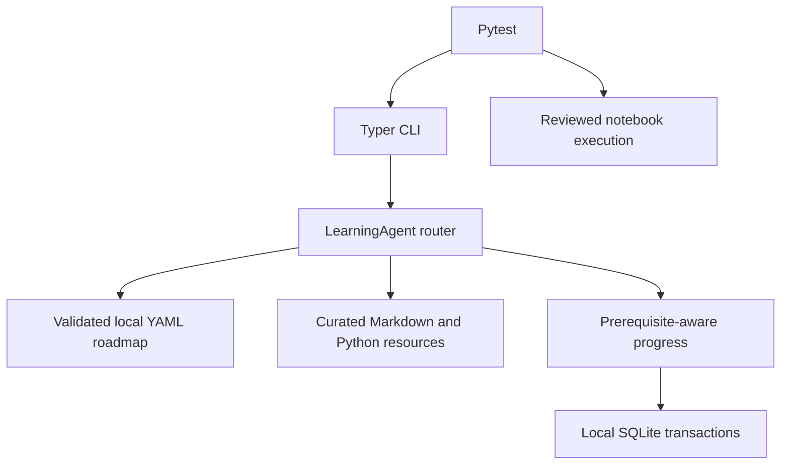

# Python AI Learning Agent - Phase 1

A working **offline learning companion**, implemented in Python 3.11+. It is a
deterministic local application, not an LLM-powered or autonomous agent yet.
No API key, internet connection, or network device is required after installation.

## Launch from the existing VS Code terminal (PowerShell)

The environment was created locally with approval. You do not need to activate
it or change PowerShell execution policy:

```powershell
Set-Location 'C:\Users\v-yaalam\Downloads\vscode_Dell_17-1\AI & ML\Agent_AI\python-ai-learning-agent'
.\.venv\Scripts\python.exe -m python_learning_agent --help
.\.venv\Scripts\python.exe -m python_learning_agent learn variables
```

Open **this project subfolder** as a VS Code folder to enable its `.vscode`
settings. Select `.venv\Scripts\python.exe` using **Python: Select Interpreter**.
For notebooks, select the same environment in the notebook kernel picker.
The included debug configuration runs `learn variables`.
No settings in the surrounding workspace have been changed.

### Fresh installation on another machine

Installation requires internet access unless dependencies are already cached.
Run these commands yourself; the application never installs packages:

```powershell
python -m venv .venv
.\.venv\Scripts\python.exe -m pip install -e '.[dev]'
```

The supported installation is **editable from this checkout**. Lesson and YAML
assets intentionally remain visible at the project root; they are not bundled in
a standalone wheel. A relocated package requires `PYTHON_LEARNING_ROOT` to point
to a checkout containing `curriculum` and `lessons`.

## Guided and exploration modes

```powershell
.\.venv\Scripts\python.exe -m python_learning_agent next-topic
.\.venv\Scripts\python.exe -m python_learning_agent learn variables
.\.venv\Scripts\python.exe -m python_learning_agent practice variables
.\.venv\Scripts\python.exe -m python_learning_agent practice variables --solutions
.\.venv\Scripts\python.exe -m python_learning_agent quiz variables
.\.venv\Scripts\python.exe -m python_learning_agent progress
.\.venv\Scripts\python.exe -m python_learning_agent progress --difficult variables
.\.venv\Scripts\python.exe -m python_learning_agent revise
.\.venv\Scripts\python.exe -m python_learning_agent revise variables
.\.venv\Scripts\python.exe -m python_learning_agent progress --complete variables
.\.venv\Scripts\python.exe -m python_learning_agent roadmap
.\.venv\Scripts\python.exe -m python_learning_agent explain variables
.\.venv\Scripts\python.exe -m python_learning_agent explore variables
```

`learn` marks a lesson **started**, never completed automatically. `explain` and
`explore` read curated content without changing progress. Completion is your
explicit self-assessment, not proof of competence. Quiz results are recorded
separately; scores below 80% request revision. A later passing quiz or explicit
completion clears that revision request. A historical difficult flag remains
visible, so you can see topics that previously needed attention.

`next-topic` prioritizes revision, then prerequisite-ready, incomplete, available
lessons. Once the only available lesson is completed it reports `operators` as
the next **planned** topic rather than pretending its lesson exists.

Unknown topics and planned topics produce clear nonzero-exit errors. For example,
`explain decorators` currently says its lesson is planned and suggests variables.
Phase 1 uses exact roadmap IDs, not natural-language chat.

## Demonstration lesson

**Python Variables, Data Types, and Memory Fundamentals**

| Artifact | Location |
| --- | --- |
| Lesson guide and detailed notes | `lessons\beginner\01_variables\README.md`, `notes.md` |
| Seven runnable demonstrations | `lessons\beginner\01_variables\examples.py` |
| Six practice functions | `lessons\beginner\01_variables\exercises.py` |
| Explained reference solutions | `lessons\beginner\01_variables\solutions.py` |
| Six scored questions | `lessons\beginner\01_variables\quiz.json` |
| Interactive notebook and two diagrams | `notebooks\beginner\01_variables.ipynb` |
| Automated function assessments | `tests\test_lesson.py` |

```powershell
.\.venv\Scripts\python.exe lessons\beginner\01_variables\examples.py
.\.venv\Scripts\python.exe lessons\beginner\01_variables\solutions.py
.\.venv\Scripts\python.exe -m notebook notebooks\beginner\01_variables.ipynb
```

The notebook explains every example, contains guided experiments, practice,
solutions and assertions, and visualizes both name bindings and direct object
sizes. The size chart is interpreter-dependent, not recursive memory accounting.

### Execute and export the demonstration

Review notebook content before executing it. This export command uses the same
Python interpreter as the command itself and refuses to overwrite any existing
output directory:

```powershell
.\.venv\Scripts\python.exe scripts\export_demo.py reports\my-variables-run
```

The new directory contains an executed notebook, `bindings.png`, and
`direct-object-sizes.png`. Choose a new output name for subsequent runs.

### Practice safely and test your own work

Copy `exercises.py` to a new file outside the reference lesson before editing.
It deliberately raises `NotImplementedError` until you implement each exercise.
Do not change the supplied solutions just to make an assessment pass.

After you have reviewed and trust your code:

```powershell
$env:LEARNING_EXERCISE_FILE = 'C:\path\to\your\variables_practice.py'
.\.venv\Scripts\python.exe -m pytest tests\test_lesson.py -q
Remove-Item Env:LEARNING_EXERCISE_FILE
```

**This imports and executes your file in the local test process. It is not a
sandbox and has no security isolation or resource limits.** Do not use it for
untrusted downloaded/model-generated code. Normal tests use the authored
solutions, not unfinished exercises.

## Curriculum and architecture

Six YAML tracks cover beginner, intermediate, advanced, professional Python,
network automation, and AI engineering. Every track has a planned capstone.
Topics form a validated acyclic prerequisite graph. Within a track, a topic
depends on its predecessor unless it explicitly supplies another prerequisite
list. Roadmap ordering is topological, not dependent on file discovery order.
Only `variables` has complete teaching content in Phase 1.



Modules are implemented only where they have useful Phase 1 behavior. Empty
future agents, unimplemented SDK adapters, and placeholder lesson directories
are intentionally absent.

Progress lives in `data\progress.sqlite3`, created on first use. Tests use
temporary databases and do not contaminate personal progress. The database
stores started/completed topics, study timestamps in UTC, quiz attempt history,
best scores, difficulty flags and revision requirements.

Optional PowerShell configuration:

```powershell
$env:PYTHON_LEARNING_DATA_DIR = 'C:\path\to\private-learning-data'
$env:PYTHON_LEARNING_ROOT = 'C:\path\to\python-ai-learning-agent'
```

`.env.example` documents these variables; `.env` files are not automatically
loaded. No external model is called, and no API-key configuration is implemented
in Phase 1. Databases are ordinary local files, not encrypted storage; do not put
credentials or confidential infrastructure data into lesson content.

## Quality checks

From the project directory:

```powershell
.\.venv\Scripts\python.exe -m pytest -q
.\.venv\Scripts\python.exe -m ruff check .
.\.venv\Scripts\python.exe -m ruff format --check .
.\.venv\Scripts\python.exe -m mypy src
```

Pytest includes schema validation and real execution of the bundled notebook,
checks that both figures render, pins the kernel to the test interpreter, and
tests exact example output, solution edge cases, CLI flows, persistence,
quiz evaluation and invalid prerequisite graphs. No credentials or paid API
are used. Strict mypy targets Python 3.11 application code. NumPy stubs are
excluded from import following because newer optional visualization dependencies
on newer interpreters can contain syntax not available in the minimum Python
version; application modules do not depend on NumPy.

On Windows, Jupyter/ZeroMQ may report a Proactor-event-loop compatibility warning
and use its selector-thread fallback. The warning is not suppressed; execution
and assertions must still succeed.
The installed kernel also warns that its local TCP transport is unencrypted.
Do not expose notebook/kernel ports to untrusted networks or execute notebooks
containing secrets. This project does not provide a hardened notebook server.

CI is deferred to Phase 5 as requested. No workflow has been installed at the
parent repository root or hidden in an ineffective nested `.github\workflows`
directory. Tests and tools are ready to be wired into a future scoped workflow.

## Scope and next phase

Implemented: offline CLI, curriculum validation, SQLite persistence,
prerequisite-aware recommendations, one complete beginner lesson, exercises,
quiz, executable notebook, visualizations, editor configuration, and tests.

Not implemented: multi-level teaching generation, arbitrary natural-language
requests, generated notes or code, automated debugging, LLM providers, secure
code sandboxing, exercise-attempt/project tracking, interactive multi-session
curriculum adaptation, network/ML labs, and capstone projects. The network and
AI tracks are roadmaps only. No application command connects to devices or
executes configuration changes.

Phase 2 should add more curated lessons, reusable lesson structures, and richer
exercise tracking and teaching workflows. It requires your confirmation.
See `reports\PHASE1_REPORT.md` for the actual completion and validation record.

### Technical references

The lesson follows the Python documentation's *Data model*, *copy: shallow and
deep copy operations*, and *Floating-Point Arithmetic: Issues and Limitations*.
Editor configuration follows the VS Code *Python settings reference* and
*Python debugging* documentation. Notebook metadata follows the Jupyter
nbformat 4.5 schema. The CLI tests use Typer's documented `CliRunner`.
