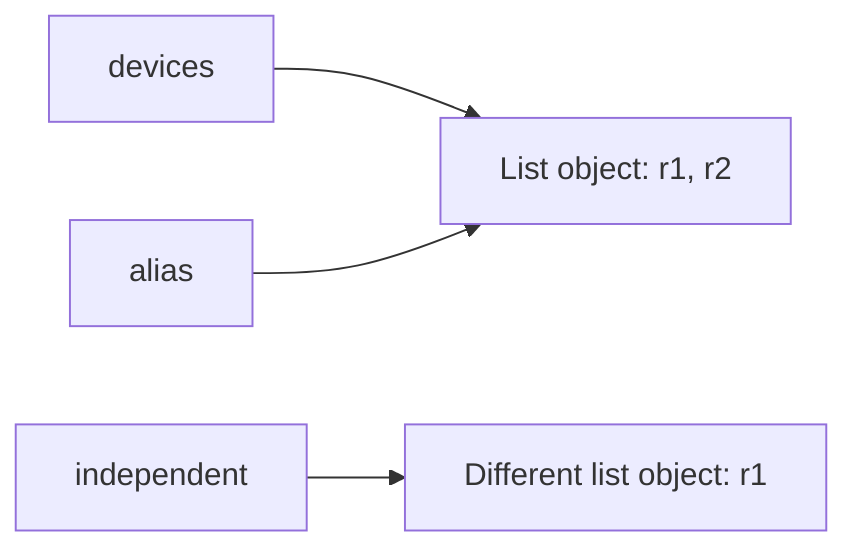

# Python Variables, Data Types, and Memory Fundamentals

## Objectives and prerequisites

No programming knowledge is assumed. You need Python 3.11 or newer, a terminal,
and the ability to open a file. After this lesson you should be able to:

1. Bind a descriptive name to a value and predict the effect of reassignment.
2. Recognize `int`, `float`, `str`, `bool`, `None`, and common containers.
3. Convert text to numbers intentionally and explain conversion failures.
4. Distinguish an object, its type, its value, its identity, and a name.
5. Predict list aliasing, shallow copying, and immutable value behavior.
6. Diagnose common name/type errors and test your predictions.

## 1. Intuition: names are labels, not storage boxes

Think of a Python object as a card containing a value. A variable name is a
removable label pointing to that card. Multiple labels can refer to the same
card. Moving one label does not automatically move the other labels.

```python
device_count = 3
backup_count = device_count
device_count = 4
print(device_count, backup_count)
```

Output: `4 3`.

Line by line:
- `device_count = 3` binds a name to an integer object representing three.
- `backup_count = device_count` binds another name to that same value/object.
- `device_count = 4` rebinds only the first name; it does not mutate the integer.
- `print(...)` displays the two current values separated by a space.

Assignment uses `=`. Equality comparison uses `==`. `count == 3` asks a question;
it does not assign three to `count`.

## 2. Technical model: objects have types; names can be rebound

An object's type determines its supported operations. A name does not have a
permanent runtime type: `value = 3; value = "three"` is legal, but changing what
a name means can make code hard to understand. Type hints document intent and
help static tools; they do not automatically validate values at runtime.

| Value | Type | Meaning | Useful operation |
| --- | --- | --- | --- |
| `12` | `int` | Integer, arbitrary precision subject to available memory | `12 + 1` |
| `12.5` | `float` | Approximate binary floating-point number | `12.5 / 2` |
| `"router"` | `str` | Immutable Unicode text | `"router".upper()` |
| `True` | `bool` | Truth value (a subclass of `int`) | `not True` |
| `None` | `NoneType` | Absence of a value | `value is None` |
| `["r1", "r2"]` | `list` | Ordered mutable sequence | `devices.append("r3")` |
| `("r1", "r2")` | `tuple` | Immutable sequence of references | `devices[0]` |
| `{"r1", "r2"}` | `set` | Unique elements, not a positional sequence | `"r1" in devices` |
| `{"name": "r1"}` | `dict` | Mutable key/value mapping | `device["name"]` |

A tuple cannot have its elements rebound, but an element may itself refer to a
mutable object. Immutability of the outer tuple is not a deep freeze.

Use `type(value).__name__` to inspect a type. Use `isinstance(value, int)` when
asking whether a value belongs to a type family. Remember that
`isinstance(True, int)` is true; validate booleans separately if they must not
count as numeric input.

## 3. Syntax, naming, and evaluation

```python
device_name: str = "lab-router"
interface_count = 24
utilization = 0.25
is_online = True
description = None
print(f"{device_name}: {interface_count} interfaces")
```

Output: `lab-router: 24 interfaces`.

The first line includes an optional annotation, `str`, and a string literal.
The next four lines bind integer, float, Boolean, and absence values.
The final line uses an f-string: expressions inside braces are evaluated and
inserted into text. Quotes delimit text and are not printed.

Use `snake_case`, start names with a letter or underscore, and avoid keywords
such as `class`. Names are case-sensitive: `Device` and `device` are different.
Avoid hiding built-ins with names such as `list`, `str`, or `type`.

The right-hand side is evaluated before assignment. If `count = int("oops")`
fails, that statement does not assign a new value to `count`.

## 4. Six executable examples

The companion `examples.py` runs the following examples in order without input
or network access.

### Example 1: rebinding

```python
count = 3
previous = count
count = 4
print(count, previous)  # 4 3
```

The first assignment creates a binding, the second shares its original object,
the third moves one binding, and the fourth shows that the other stays unchanged.
This is useful for keeping an earlier measurement.

### Example 2: inspect scalar types

```python
values = [3, 2.5, "router", True, None]
print([type(value).__name__ for value in values])
```

Output: `['int', 'float', 'str', 'bool', 'NoneType']`.
The first line creates five objects in a list. The second uses a comprehension:
it visits each value, obtains the type name, and collects those names into a
new list. Do not worry about writing comprehensions yet; a later lesson covers
them. Type inspection helps when a file supplies text where a number is expected.

### Example 3: text conversion and validation

```python
raw_count = "24"
interface_count = int(raw_count)
print(interface_count + 1)
```

Output: `25`. First store text, then parse it, then do numeric addition.
`"24" + "1"` produces `"241"` instead: `+` concatenates strings.
`int("twenty-four")` raises `ValueError`. In the full script, `parse_count`
rejects negative numbers and nonnumeric text with a clear error message.

### Example 4: shared mutable list

```python
devices = ["r1"]
alias = devices
alias.append("r2")
print(devices)
```

Output: `['r1', 'r2']`.
The first line makes one list. The second line adds a name, not a copy.
The third mutates the shared list; the fourth reads that same object through
the first name. Shared inventories can therefore change unexpectedly.

### Example 5: independent outer list

```python
devices = ["r1"]
independent = devices.copy()
independent.append("r2")
print(devices, independent)
```

Output: `['r1'] ['r1', 'r2']`.
The second line makes a new outer list, so the append affects only that list.
This is a **shallow** copy: nested objects would still be shared. For example,
`outer = [["r1"]]; copied = outer.copy(); copied[0].append("r2")`
also changes `outer[0]`. Copy deliberately; do not assume all data is independent.

### Example 6: equality is not identity

```python
left = [1, 2]
right = [1, 2]
print(left == right, left is right)
```

Output: `True False`. Two list expressions create distinct objects.
`==` compares their values; `is` compares identity. Use `is None` for the
absence sentinel; do not use `is` to compare numbers or strings. Interpreter
interning and object reuse make identity-based value comparisons unreliable.

### Full script output

```text
1. Rebinding: 4 3
2. Types: ['int', 'float', 'str', 'bool', 'NoneType']
3. Conversion: 25
4. Shared list: ['r1', 'r2']
5. Copied list: ['r1'] ['r1', 'r2']
6. Equality and identity: True False
7. Invalid input: Count must be an integer written as text.
```

## 5. Memory foundations without implementation myths



Follow each arrow to find the object a name references. Mutating a shared list
is visible through both names. Rebinding `alias` would move only its arrow.

`id(obj)` returns an identity token that is unique for that object's lifetime.
Its exact number is not useful lesson output; do not treat it as a portable
memory address or assume it remains unique after an object is destroyed.

Python manages object lifetimes automatically. CPython commonly uses reference
counting plus cyclic garbage collection, but immediate reclamation is not a
portable language guarantee. `del name` removes a binding, not necessarily an
object. Other references can keep the object alive. Use context managers for
files and sockets rather than relying on destruction timing.

`sys.getsizeof(obj)` is implementation-dependent and usually measures only
the object itself, not the whole graph of referenced objects. The notebook's
bar chart compares **direct sizes on the current interpreter**, not total
application memory. Read relative differences, not universal byte constants.

## 6. Numerical and practical foundations

Integers represent whole counts exactly. A float generally approximates real
values: `0.1 + 0.2 == 0.3` is false on normal binary floating-point Python builds.
For approximate measurements, compare with `math.isclose`; financial decimal
arithmetic has different requirements and deserves a separate lesson.

Real uses include converting an interface count from a CSV file, storing a
device's name, keeping a Boolean link state, and distinguishing missing readings
(`None`) from a genuine zero. Do not convert untrusted text using `eval`.

## 7. Common mistakes and a debugging method

| Symptom | Likely cause | Minimal correction |
| --- | --- | --- |
| `NameError: name 'cout' is not defined` | Typo or use before binding | Check spelling and execution order |
| `TypeError` when adding `"24"` and `1` | Text and integer mixed | Parse with `int` after validation |
| `ValueError` from `int("abc")` | Invalid numeric text | Reject the input or ask for a correction |
| Both lists change | Two names reference one list | Copy if independent state is intended |
| Unexpected identity result | `is` used for value comparison | Use `==` |
| `SyntaxError` near an assignment | Invalid name or missing quote | Inspect the exact indicated statement |

Read the final traceback line for the exception type and message. Then inspect
the last frame belonging to your code. Write down the expected type and value,
print `repr(value)` and `type(value).__name__`, reproduce the smallest failing
case, apply one correction, and add a regression assertion.

Example diagnosis: `raw = "24"; print(raw + 1)` fails because the string's
addition operation cannot concatenate an integer. Use `print(int(raw) + 1)`.
The correction works because both operands are now integers. A regression test
should check both valid input `"24"` and rejected text `"abc"`.

## 8. Guided experiments

Predict each result **before** running it:

1. Rebind `alias = []` after creating a shared list. Does `devices` change?
2. Replace `.append("r2")` with `alias = alias + ["r2"]`. Is the original list changed?
3. Try `int(" 24 ")`, `int("2.4")`, and `int("-1")`. Which parse, and which are
   acceptable counts? Parsing and business validation are different steps.
4. Compare `bool("")`, `bool("False")`, and `bool(0)`. A nonempty string is truthy,
   even if its text says `"False"`.
5. Make a list containing another list, shallow-copy it, and mutate the inner
   list. Explain the arrows before deciding whether deeper copying is appropriate.

## 9. Exercises and assessment

Implement the six functions in a copy of `exercises.py`:

1. Format a device label from a name and nonnegative integer interface count.
2. Parse a nonnegative integer from text; reject invalid text and negative counts.
3. Report the type names of values without changing them.
4. Add a device to a new outer list without changing the input list.
5. Compare two lists by value and by identity and return both answers.
6. Convert Celsius to Fahrenheit using `F = C * 9 / 5 + 32`.

Each function includes example inputs and expected results.
`solutions.py` explains each solution in its docstring.
Use the quiz command for multiple-choice, output-prediction, debugging, and
code-completion questions. These questions are local curated content, not
AI-generated assessments. A score below 80% schedules revision.

## 10. Interview and revision questions

- What is the difference between binding, rebinding, and mutation?
- Why does `alias = original` not copy a list?
- When should `is` be used instead of `==`?
- Does a type hint reject the wrong runtime type automatically?
- Why does deleting a variable not guarantee that an object is destroyed?
- What does a shallow copy share, and why does that matter for nested inventories?
- Why can a numeric-looking string still cause a type error?

Answer in your own words and support every answer with a small example.

## Summary and revision checklist

- [ ] I can trace names to objects and predict rebinding.
- [ ] I can identify core scalar and container types.
- [ ] I can intentionally parse text and explain conversion errors.
- [ ] I can predict shared-list mutation and shallow-copy behavior.
- [ ] I use `==` for values and `is None` for the absence sentinel.
- [ ] I know type hints and direct memory-size measurements have limits.
- [ ] I completed six exercises and reviewed all quiz explanations.

Mark completion yourself only when confident:
`python -m python_learning_agent progress --complete variables`.
The next roadmap topic is `operators`; its full lesson is planned for a later phase.
